# Adapt — November 2026 Social Media

Back to the [November plan](november-2026-plan.html) · [Calendar](november-2026-calendar.html)

**Short, fun and off the cuff.** Every inspiration post was rewatched for this plan, and the ones that work are tiny: one clip or one photo with text on top. Most reels are 5–15 seconds, and three of the four carousels reuse **one photo** on every slide. Only the two follow-along videos run longer. Nobody memorizes a script. The words go on screen and in the caption, not in anyone's mouth.

**November = 12 posts:** a 3-post reintro set to pin at the top of the grid, 5 quick reels, 3 carousels and the Black Friday graphic. Daisy films, designs, edits and posts. Dr. Mike approves before anything goes live.

## Posting plan

| Date | Post | Format | Who's in it | Length | Inspired by |
| --- | --- | --- | --- | --- | --- |
| Mon Nov 2 | **Reintro set (post all 3, then pin):** Meet Dr. Mike · Meet Dr. Kyndra · What to expect at Adapt | 3 graphic carousels | Dr. Mike, Dr. Kyndra | 3–4 slides each | [@alexathechiro's 3 pinned posts](https://www.instagram.com/alexathechiro/) · arrows like [@drwajeehapt](https://www.instagram.com/p/DeWoXBuiJKL/) |
| Tue Nov 3 | "What makes you different?" | Reel | Dr. Mike | 5–7 sec | [@occhiropractor](https://www.instagram.com/p/DVM4gRFgVwt/) |
| Thu Nov 5 | Rock, paper, scissors: myth vs. fact | Carousel (1 photo) | Hands only | 7 slides | [@thephysiofix](https://www.instagram.com/p/Deb6v1EmyKa/) |
| Tue Nov 10 | Pickleball, tennis & golf players: let's fix your elbow | Reel (follow-along) | Dr. Kyndra | 45–60 sec | [@thatchirowithtattoos](https://www.instagram.com/p/Dd1mbt5vPuS/) |
| Thu Nov 12 | Things I don't care about as your chiropractor | Carousel (1 photo) | Dr. Kyndra | 6 slides | [@drmollypluss](https://www.instagram.com/p/DboYRaeCdQK/) |
| Mon Nov 16 | All you desk workers: let's fix your neck | Reel (follow-along) | Dr. Mike | 45–60 sec | [@thatchirowithtattoos](https://www.instagram.com/p/Dd1mbt5vPuS/) |
| Tue Nov 17 | All you runners: let's fix your Achilles | Reel (follow-along) | Dr. Kyndra | 45–60 sec | [@thatchirowithtattoos](https://www.instagram.com/p/Dd1mbt5vPuS/) |
| Thu Nov 19 | 4 red flags at a chiropractor | Reel | Dr. Mike + Dr. Kyndra | 12–15 sec | [@dr.jessbrubaker](https://www.instagram.com/p/DH9cEhHpYXD/) |
| Tue Nov 24 | Why you tried chiropractic and it didn't work | Carousel (1 photo) | Dr. Mike | 6 slides | [@livingrootedchiro](https://www.instagram.com/p/DaESDA9mkNy/) |
| Fri Nov 27 | Black Friday: gift cards + use your HSA/FSA by Dec 31 | Graphic | — | 1 slide | — |

**The follow-along series:** three reels in the same format, one for each crowd: pickleball, tennis & golf players (elbow), desk workers (neck) and runners (Achilles). The elbow and Achilles reels go out the same day their new pages go live. The email sends Thu Nov 12.

**Swap-in, ready to go:** Spine conditions explained with Oreos (carousel, photographed tomorrow). Use it if any post falls through, or post it in December.

**Moved to December** (shoot only if there's time tomorrow): Sleeping positions ranked · "How have you been?" · Still hurting after the season? carousel · 4 things I'd never do.

## Extra ideas

Ready-to-go ideas to get more of Adapt's services on the feed. Use them as swap-ins this month, or to plan December. Each was found and watched on Oct 26.

### Burnout + hyperbaric chamber (from Dr. Kyndra)

Dr. Kyndra wants a "burnout" video to promote the hyperbaric chamber (HBOT), which isn't being used much lately. These are ready to go whenever there's a slot, or as a swap-in this month. If there's time tomorrow, grab the B-roll so we have it.

| Idea | Format | Who's in it | Inspired by | Adapt spin |
| --- | --- | --- | --- | --- |
| **"They said relax. I heard 'bring your laptop.'"** | Reel, 6–8 sec | Dr. Kyndra (or a willing patient with a signed release) | [@avni](https://www.instagram.com/p/DeDWPOfvJ3N/) (1.3K likes, 6.5 sec selfie in a chamber) | Selfie-angle shot lying in the chamber, then the camera tips down to a laptop or phone full of emails. Caption: "Burnt out but your inbox isn't? 60 minutes in the chamber is the only meeting you should take today." Adapt's chamber allows laptops, so this works as-is |
| **What a session in our hyperbaric chamber actually looks like** | Carousel, 5 slides (B-roll stills) | Dr. Kyndra | [@onebasehealth](https://www.instagram.com/p/DZYZYlCDYRx/) "What 60 minutes of HBOT does to a burnt-out brain" | Keep it about the experience, not medical claims: 1. "Burnt out? Here's 60 minutes of doing nothing" · 2. You lie back and get comfy · 3. Your ears pop like on a plane · 4. You rest, read or nap · 5. "Who uses it here: athletes in recovery + anyone who needs a reset · Text (408) 673-2432" |
| **How athletes use HBOT in recovery** | Carousel or 15-sec reel | Dr. Kyndra + B-roll | [@henshaw_hyperbarics](https://www.instagram.com/p/DcNlpThoB9N/) | Fits the athlete theme: "Your recovery routine: sleep · fuel · strength · chamber time." B-roll of the chamber door closing and someone relaxing inside |
| **"What do patients notice after HBOT?"** | Carousel | Real patients (quotes only) | [example post](https://www.instagram.com/p/DaBRIvzjLAe/) "What do people actually notice after HBOT?" | Later month. Only real quotes from patients who said yes to being quoted, never made up |

**B-roll to grab tomorrow, if there's time:** the chamber from the outside · the door closing · someone lying inside, relaxed (Dr. Kyndra) · a close-up of the pressure dial or control panel · the room.

**Watch the wording.** The FDA clears hyperbaric oxygen for a specific list of medical conditions, and burnout, stress and brain fog aren't on it. So these posts sell the *experience* (rest, a reset, recovery) and not a cure. No "treats burnout" or "heals your brain" claims. Dr. Kyndra checks every HBOT post before it goes to Dr. Mike.

### Shockwave, laser, personal training + massage

Most of these need Eli, Dr. Paris or Nathalia on camera, so they fit a December shoot. The shockwave and laser ones work with Dr. Mike or Dr. Kyndra, so grab that B-roll tomorrow if there's time.

| Service | Idea | Format | Who's in it | Inspired by | Adapt spin |
| --- | --- | --- | --- | --- | --- |
| **All services** | **"Tell me you're Adapt without telling me"** | Graphic carousel | Dr. Mike or Dr. Kyndra (cut-out photo) | [@bodyworkdoc](https://www.instagram.com/p/DZx3ROrjf46/), "Tell me you're a chiropractor without telling me: my essential items" | Cut-out photo of a doctor surrounded by labeled photos of the gear: shockwave · laser · hyperbaric chamber · massage table · dumbbells and bands · adjusting table. Hand-drawn arrows and labels like the reintro posts. One post that shows off every service |
| **Shockwave** | **"Is shockwave painful? Does this answer that?"** | Reel, about 13 sec | Dr. Kyndra treating Dr. Mike (or a willing patient) | [@drgabbycap](https://www.instagram.com/p/DSLRoHtkiq3/) | Close-up of shockwave on a back or elbow while the "patient" gives a calm thumbs up or a funny face. Caption: what it actually feels like and how the intensity gets adjusted to you |
| **Shockwave** | **"Client: so what do you do when you're not looking after me?"** | Reel, about 11 sec | Dr. Kyndra | [@izzyintheclinic](https://www.instagram.com/p/DYNxpXRye14/) | Dr. Kyndra sitting on the table using the shockwave on her own knee or elbow, sipping coffee. Funny and shows the machine up close |
| **Laser** | **Laser therapy explainer** | Reel, 30–45 sec | Dr. Mike next to the laser | [@juanpablochica](https://www.instagram.com/p/DaRPMB1qoz9/) (51 sec, talking head beside the laser) | Off-the-cuff: "Got an injury that's keeping you off the field? Here's what this does." Cut to B-roll of the laser on a knee or shoulder. Keep it to what laser is used for, no cure claims |
| **Personal training** | **"POV: you try the exercises you give your athletes"** | Reel, about 7 sec | Eli or Dr. Paris | [@optimum.pt.missouricity](https://www.instagram.com/p/DI0JUIKMRE1/) (49K likes) | The trainer does a tough split squat or a single-leg move and wobbles or struggles. Funny and relatable, and it shows the rehab gym |
| **Personal training** | **"POV: your trainer is good at their job"** | Reel, about 9 sec | Eli or Dr. Paris + a "client" | [@catcodedmoves](https://www.instagram.com/p/DbjvudZNkmY/) (10K likes) | Trainer: *"You don't have to do your exercises today, okay?"* The client immediately starts doing them. Reverse psychology humor |
| **Personal training** | **"It's not just massages"** | Reel, about 14 sec | Eli or Dr. Paris | [@eliteptnj](https://www.instagram.com/p/DRw38T-AMt0/) (185K likes, "Physical therapy isn't just massages") | Spin: "Chiropractic isn't just cracking backs," then cuts of the strength training, rehab and the gym at Adapt |
| **Massage** | **"POV: your first-time client says…"** | Reel, about 8 sec | Nathalia or Eli | [@balancedbodyjm](https://www.instagram.com/p/DZqFcjhJZcI/) (127K likes) | The therapist rubs their hands together excitedly. Text: *"POV: your first-time client says 'I've played softball for 20 years and never had a massage'"* |
| **Massage** | **"POV: your client falls asleep 10 minutes into a 90-minute session"** | Reel, about 10 sec | Nathalia or Eli + a "client" | [@moshealthmassage](https://www.instagram.com/p/DXzUYTdNy54/) (54K likes) | The therapist standing next to the table looking at the camera, deadpan, while the client snores |
| **Massage** | **"That exact moment your body tells me…"** | Reel, about 13 sec | Nathalia or Eli | [@torasavage_](https://www.instagram.com/p/DWZGLztp6z7/) (17K likes) | Close-up of hands finding a knot in the shoulder, with a knowing look at the camera. Caption: "You: I just have tight shoulders. Your body: 👀" |

**B-roll to grab tomorrow, if there's time:** the laser on a knee or shoulder · a shockwave close-up (already on the list) · the gear for the "Tell me you're Adapt" post (each machine on its own, clean background).

## Tomorrow's shoot: Tue Oct 27, 11:30–1:00

Grouped by setup so nobody moves twice. Each block lists what Daisy captures and what the doctors do.

| Time | Setup | Daisy captures | Doctors do |
| --- | --- | --- | --- |
| 11:30–11:40 | Set up | Tripod, ring light, lav mic, clean lens · tape the text cards to the wall behind the phone | Change into Adapt shirts |
| 11:40–12:10 | **Chair + plain wall** | Pickleball/tennis/golf elbow + runners Achilles follow-alongs (Dr. Kyndra) · Desk workers follow-along (Dr. Mike). Wide, vertical, full body in frame. Phone stays put | **Dr. Kyndra:** 8-second intro, then 3 moves each · **Dr. Mike:** same for the desk workers one. 2–3 reps per move |
| 12:10–12:20 | **Treatment table** | "What makes you different?" (3 takes) · Red flags clip (one 15-second continuous take, 2 angles) | **Dr. Mike:** lounge on the table · then adjust Dr. Kyndra |
| 12:20–12:30 | **Mirror + wall photos** | Mirror selfies · rock, paper, scissors hands (10+ shots each, burst mode) · **Oreo stacks** on a clean white surface (5 setups, below) | Each doctor takes their own mirror selfie · both hold out hands · Dr. Kyndra checks the Oreo labels make sense |
| 12:30–12:42 | **Reintro portraits** | 3 photos per doctor + 1 together (list below) · voice memo the intro questions | Answer 5 quick questions each (about 2 minutes) |
| 12:42–12:55 | **B-roll** | Shockwave on an elbow + a heel · adjustment · soft tissue · a strength move · front sign · front desk · treatment room empty. 5–10 seconds each, slow and steady | Act it out on each other (no patients unless they've signed a photo/video release) |
| 12:55–1:00 | **Bonus (only if time)** | HBOT B-roll (chamber, door closing, Dr. Kyndra relaxing inside) · laser B-roll · each machine on its own for the "Tell me you're Adapt" post · sleeping positions ranked · "How have you been?" walk-in | **Dr. Mike:** rank 4 positions off the cuff |

### Daisy's checklist

- [ ] Phone charged, 20GB+ free, lens wiped
- [ ] Tripod, phone clamp, ring light, lav mic
- [ ] Printed text cards in big font (all 3 follow-alongs' moves, red flags, intro questions)
- [ ] Light dumbbell or water bottle, a step or box, a massage ball
- [ ] A pillow (bonus sleeping reel)
- [ ] **Oreos** (2 packs, so some can be twisted, broken or crumbled) + a white poster board or plate for the background
- [ ] Film everything vertical 9:16, 4K 30fps. Leave 2 seconds of stillness at the start and end of each clip
- [ ] Photos: shoot each one portrait **and** with empty space above the head for text

### What the doctors need

- [ ] **Both:** Adapt shirts (bring a second color for the reintro photos), hair and face ready for close-ups, 90 minutes blocked off
- [ ] **Dr. Kyndra:** look over the follow-along moves below and swap anything she'd rather show
- [ ] **Dr. Mike:** think of 1–2 real "chiro didn't work for me" stories (no names) to use in the caption
- [ ] **Both:** be ready to answer the 5 intro questions (below). Short answers are perfect
- [ ] A clear mirror and a plain wall (any light color), and the treatment table cleared

### Photo list

| For | Shot | Notes |
| --- | --- | --- |
| Meet Dr. Mike | 1 portrait against a plain wall, waist up, arms relaxed · 1 candid while adjusting · 1 laughing or mid-sentence | Leave room above and beside him for text and arrows |
| Meet Dr. Kyndra | Same 3 as Dr. Mike | Same |
| What to expect | Front sign · front desk · treatment room · shockwave close-up · the two of them together | Wide and bright |
| Rock, paper, scissors | Dr. Mike's hand "scissors" from the left, Dr. Kyndra's hand "rock" from the right, against a plain wall | Wall gets tinted Adapt green (#019877) in editing. Hands only, no faces |
| Things I don't care about | Dr. Kyndra mirror selfie, full body, phone covering half her face, smiling | One photo for all 6 slides |
| Chiro didn't work | Dr. Mike mirror selfie, same style | One photo for all 6 slides |
| Oreo spine (swap-in) | 5 Oreo stacks on white, shot straight on at stack height, lots of empty space on the sides for labels | See the setups below. Labels and arrows get drawn on in editing |

### Intro questions (voice memo, about 2 minutes each)

1. Where are you from, and how long have you been in Campbell?
2. Why did you become a chiropractor?
3. What's the sport or activity you love most?
4. What kind of patient do you love working with?
5. One thing people would be surprised to know about you?

## Every piece: script, text and shots

### 1–3. Reintro set (Mon Nov 2, then pin all 3)

Inspired by [@alexathechiro's pinned trio](https://www.instagram.com/alexathechiro/): a photo on one side, a handwritten-style title and short text boxes on the other. Add hand-drawn arrows pointing at the photo, in brand green, like the [Oreo posts](https://www.instagram.com/p/DeWoXBuiJKL/). Fill in the blanks from tomorrow's voice memos.

**Meet Dr. Mike** (3 slides)
- Slide 1: portrait + title "Meet Dr. Mike" · arrows: "founder of Adapt" · "[sport he loves]" · "[surprising fact]"
- Slide 2: candid adjusting photo · "Why I became a chiropractor: [his answer, 1–2 lines]"
- Slide 3: laughing photo · "I love working with [his answer]. Chiropractic + rehab, so you get back to what you love." · Text (408) 673-2432

**Meet Dr. Kyndra** (3 slides)
- Same layout · arrows: "Dr. Kyndra Cervantes, D.C." · "[sport]" · "[surprising fact]"

**What to expect at Adapt** (4 slides)
- Slide 1: front sign photo · "What to expect at your first visit"
- Slide 2: treatment room · "1. We listen + do a real exam"
- Slide 3: shockwave close-up · "2. Treatment that fits you: adjustments, soft tissue, shockwave, strength"
- Slide 4: both doctors together · "3. A plan to get you back to your sport · 1475 S Bascom Ave #104, Campbell · Text (408) 673-2432"

### 4. "What makes you different?" — reel, 5–7 sec

Inspired by [@occhiropractor](https://www.instagram.com/p/DVM4gRFgVwt/), 5.5 seconds and 7.2K likes. It's just him lying on his table, feet up, on his phone, with one line of text.

- **On screen the whole time:** *CLIENT: "What makes you different from other chiropractors?"*
- **Shot:** Dr. Mike on the treatment table on his stomach, feet kicked up, scrolling his phone. He slowly looks up at the camera and gives a little smirk. One take, no talking.
- **Audio:** a trending sound
- **Caption:** "Kick your feet up, you're in good hands 😌 Adjustments, soft tissue, shockwave + strength, all under one roof. Text (408) 673-2432 to book."

### 5. Rock, paper, scissors: myth vs. fact — carousel, 7 slides

Inspired by [@thephysiofix](https://www.instagram.com/p/Deb6v1EmyKa/) (5.5K likes). Every slide is the **same photo**: scissors on the left (the myth) and rock on the right (the fact, which wins). Only the text changes.

| Slide | Scissors (top left) | Rock (bottom right) |
| --- | --- | --- |
| 1 | Rock, paper, scissors | Adapt edition |
| 2 | Pain is bad | Pain is information |
| 3 | Rest is best | Movement is medicine |
| 4 | Stop your sport | Modify your sport |
| 5 | Ice it and wait | Get it checked |
| 6 | Cookie-cutter care | A plan built for you |
| 7 | Which side are you on? | Text (408) 673-2432 |

**Caption:** "We might be a little biased on which side wins 😏 Movement is medicine. What would you add?"

### 6. Pickleball, tennis & golf players: let's fix your elbow — reel, 45–60 sec

Inspired by [@thatchirowithtattoos](https://www.instagram.com/p/Dd1mbt5vPuS/) (41K likes): a short seated intro to camera, then each move with a label and "3 sets of 10" on screen. Tripod never moves.

- **Title box (whole video):** *Pickleball, Tennis & Golf Players: Let's Fix Your Elbow*
- **Dr. Kyndra, seated (off the cuff, about 8 sec):** "All you paddlers, tennis and golf players, if your elbow's still sore after weeks of rest, let's fix it. Do these with me."
- **Move 1:** *Wrist extensor stretch* · arm straight, palm down, pull the hand gently toward you · "Hold 30 sec, 3x"
- **Move 2:** *Slow wrist lowering* · light dumbbell, lift with the other hand, lower slowly for a 3-count · "3 sets of 10"
- **Move 3:** *Forearm roll* · massage ball on the table, roll the top of the forearm · "1 minute"
- **End card:** "Still there after 6 weeks? That's where shockwave comes in. Text (408) 673-2432"
- **Caption:** link to the new tennis elbow page

### 7. Things I don't care about as your chiropractor — carousel, 6 slides

Inspired by [@drmollypluss](https://www.instagram.com/p/DboYRaeCdQK/). One mirror selfie on every slide, with the title at the top and one line per slide. Dr. Kyndra should swap in her own answers. These are just starters.

- Slide 1: "Things I don't care about as your chiropractor…"
- Slide 2: "If your joints pop really loud. Honestly, it's kind of satisfying 😂"
- Slide 3: "If you skipped your exercises this week. (Okay, maybe a little.)"
- Slide 4: "If you've already seen 3 other people for this. We'll figure it out together."
- Slide 5: "If you show up straight from the gym. Sweaty is welcome here."
- Slide 6: "What I DO care about? Getting you back to what you love 💚 Text (408) 673-2432"

### 8. All you runners: let's fix your Achilles — reel, 45–60 sec

Same setup and style as the elbow reel, filmed back to back.

- **Title box:** *All You Runners: Let's Fix Your Achilles*
- **Dr. Kyndra, seated (about 8 sec):** "All you runners, if your Achilles is sore every morning, try these before your next run."
- **Move 1:** *Wall calf stretch* · knee straight, then bent · "30 sec each, 2x"
- **Move 2:** *Slow heel drops off a step* · up on both feet, lower on one for a 3-count · "3 sets of 10"
- **Move 3:** *Ankle circles* · seated · "10 each way"
- **End card:** "Still sore after 2 weeks? Get it checked. Text (408) 673-2432"
- **Caption:** link to the new Achilles page

### 8b. All you desk workers: let's fix your neck — reel, 45–60 sec · Dr. Mike

Same format as [@thatchirowithtattoos' "Hypermobile girlies, let's strengthen your shoulders"](https://www.instagram.com/p/Dd1mbt5vPuS/) (41K likes), with an Adapt spin: desk workers instead of hypermobile girlies, and Dr. Mike as the face. Same chair and wall, filmed right after Dr. Kyndra's two. Posts on a Monday, back-to-the-desk day.

- **Title box (whole video):** *All You Desk Workers: Let's Fix Your Neck*
- **Dr. Mike, seated (off the cuff, about 8 sec):** "All you desk workers, if your neck's tight by 3pm, let's fix it. Do these with me."
- **Move 1:** *Chin tucks* · sit tall, glide the chin straight back, hold 3 sec · "10 reps"
- **Move 2:** *Upper back extension over the chair* · hands behind head, lean back over the top of the chair · "10 reps"
- **Move 3:** *Seated twist* · arms crossed, rotate slowly side to side · "10 each way"
- **End card:** "Do this every afternoon. Still tight? Text (408) 673-2432"
- **Caption:** "Tag the coworker who needs this 👀"

### 9. 4 red flags at a chiropractor — reel, 12–15 sec

Inspired by [@dr.jessbrubaker](https://www.instagram.com/p/DH9cEhHpYXD/). It's **one continuous clip** of an adjustment, with a text box that changes every 3 seconds. Nobody talks; the full explanation goes in the caption.

- **0–3 sec:** "4 red flags to look out for at a chiropractor 🚩"
- **3–6 sec:** "1. They spend 5 minutes with you and never ask about your life"
- **6–9 sec:** "2. Everyone gets the exact same treatment"
- **9–12 sec:** "3. No exercises or homework to keep it from coming back"
- **12–15 sec:** "4. No plan for when you're done"
- **Shot:** Dr. Mike treating Dr. Kyndra on the table: soft tissue, then an adjustment. Wide, steady, 15+ seconds
- **Caption:** expand each red flag in 1–2 lines + "You deserve a plan, not just a pop."

### 10. Why you tried chiropractic and it didn't work — carousel, 6 slides

Inspired by [@livingrootedchiro](https://www.instagram.com/p/DaESDA9mkNy/). It's one mirror selfie, darkened, with a numbered heading and a short paragraph on each slide.

- Slide 1: "Why you tried chiropractic and it didn't work"
- Slide 2: "1. You stopped too soon. Pain goes away before the problem does."
- Slide 3: "2. You only got adjusted. No soft tissue work, no strength. The adjustment opens the door, but the rest keeps it open."
- Slide 4: "3. Nobody figured out why. A real exam first, then treatment."
- Slide 5: "4. You never got homework. A few minutes a day matters."
- Slide 6: "That's why we do chiropractic AND rehab. Text (408) 673-2432"

### Swap-in: Spine conditions explained with Oreos — carousel, 6 slides

Inspired by [@drwajeehapt part 1](https://www.instagram.com/p/DeWoXBuiJKL/) and [spine terms](https://www.instagram.com/p/Deg8PDNiKnd/). Each slide is a stack of Oreos (the cookies are the vertebrae and the cream is the disc), with a bold blue title and hand-drawn arrows and labels in brand green. No doctor needed on camera. Dr. Kyndra checks the wording.

| Slide | Oreo setup to photograph | Title + labels |
| --- | --- | --- |
| 1 | Neat straight stack of 6 | "Your spine, explained with Oreos 🍪" · arrows: "vertebra" (cookie) · "disc" (cream) |
| 2 | Same straight stack | "Healthy spine" · "discs cushion every move" |
| 3 | Stack with one cookie's cream squished out the side | "Herniated disc" · "disc pushes out and can press on a nerve" |
| 4 | Stack leaning forward in a curve at the top | "Kyphosis" · "rounded upper back (hello, desk posture)" |
| 5 | Stack zig-zagging side to side | "Scoliosis" · "sideways curve of the spine" |
| 6 | One Oreo with a bite taken out, crumbs around it | "Which one sounds like you? Text (408) 673-2432" |

**Caption:** "Spine conditions, explained with Oreos 🍪 Save this for later and send it to the friend who sits at a desk all day."

### 11. Black Friday — graphic

- B-roll still of the front desk or gift card + "Give the gift of feeling good · Gift cards $100 or any amount · Got HSA/FSA dollars left? Use them before Dec 31."

### December bonus scripts (only if there's time)

- **Sleeping positions ranked** (from [@completewellness_nyc](https://www.instagram.com/p/DdZre1Uo-hw/), 309K likes, 75 sec): Dr. Mike talks to camera off the cuff and ranks each position 1–10. Daisy adds a 1–10 scale graphic in editing. Positions: stomach · side, no pillow between the knees · fetal · back · side with a pillow between the knees.
- **"How have you been?"** (from [@alexathechiro](https://www.instagram.com/p/DLnl4YmBGgn/), 6 sec): Dr. Kyndra walks down the hallway toward the camera with the text *"How have you been?"*. Then quick cuts of the table, each with a patient-style quote: *"I PR'd my deadlift!"* · *"Finally played 18 holes"* · *"Ran my first half."*

## Hooks to steal

From [@therealbrianmark's hook list](https://www.instagram.com/p/DewsR-_mwfT/), rewritten for Adapt. Swap these into captions or the first second of any reel.

| Type | Hook |
| --- | --- |
| Curiosity | "No one talks about this, but your elbow pain probably isn't from tennis." · "Here's what actually happens when you rest an injury for 6 weeks." |
| Contrarian | "The biggest lie you've been told about rest." · "Everyone gets this wrong about stretching." |
| Experience | "I used to think adjustments fixed everything, but…" · "If I could give one piece of advice to every runner…" |
| Call-out | "Stop scrolling if you've had back pain for more than 2 weeks." · "You're probably doing this at your desk without realizing." |

## Inspiration links

Every post above was watched on Oct 26 before writing this.

| Our post | Inspired by | What it actually is |
| --- | --- | --- |
| Reintro set | [@alexathechiro pinned trio](https://www.instagram.com/alexathechiro/) | 3 pinned posts: Hours · Specialties · What to expect. Photo + script title + text boxes |
| What makes you different? | [@occhiropractor](https://www.instagram.com/p/DVM4gRFgVwt/) | 5.5 sec, one shot, one line of text |
| Rock, paper, scissors | [@thephysiofix](https://www.instagram.com/p/Deb6v1EmyKa/) | 8 slides, same hands photo on a green wall |
| Elbow, Achilles + desk workers follow-alongs | [@thatchirowithtattoos](https://www.instagram.com/p/Dd1mbt5vPuS/) | 93 sec, seated intro then labeled exercises, fixed tripod |
| Things I don't care about | [@drmollypluss](https://www.instagram.com/p/DboYRaeCdQK/) | 9 slides, same mirror selfie |
| 4 red flags | [@dr.jessbrubaker](https://www.instagram.com/p/DH9cEhHpYXD/) | 11 sec, one clip, changing text |
| Chiro didn't work | [@livingrootedchiro](https://www.instagram.com/p/DaESDA9mkNy/) | 7 slides, same darkened mirror selfie |
| Sleeping positions (Dec) | [@completewellness_nyc](https://www.instagram.com/p/DdZre1Uo-hw/) | 75 sec talking head + 1–10 scale graphic |
| How have you been? (Dec) | [@alexathechiro](https://www.instagram.com/p/DLnl4YmBGgn/) | 6 sec walk-in + quick quote cuts |
| Oreo spine (swap-in) | [@drwajeehapt](https://www.instagram.com/p/DeWoXBuiJKL/) · [spine terms](https://www.instagram.com/p/Deg8PDNiKnd/) | Photo carousel with hand-drawn labels |
| Neck drill (later) | [@christinemarie.fit](https://www.instagram.com/p/De1LESMRObJ/) | 12 sec, 4 quick moves, tiny labels, music only |
| 4 things I'd never do (later) | [@dr.suzischulman](https://www.instagram.com/p/CxG9cjGO2Bq/) | 52 sec skit: acts out each one on the table, voiceover |

## Idea bank

Ideas saved while scrolling, for us to recreate or learn from in later months. Click a screenshot to see it full size. Add new screenshots to the `inspo` folder and a row here.

| Idea | How Adapt could use it | Format | Source | Screenshot |
| --- | --- | --- | --- | --- |
| **"[Job or sport]: let's fix your [body part]" series** | A recurring weekly follow-along: Golfers: low back · Lifters: shoulders · Cyclists: hips · Desk workers: neck · Pregnant mamas: hips (Dr. Kyndra, prenatal). One chair, one wall, easy to batch. His pinned ones hit 193K–711K views | Reel series | [@thatchirowithtattoos](https://www.instagram.com/thatchirowithtattoos/reels/) | <a href="inspo/thatchirowithtattoos-grid.jpg">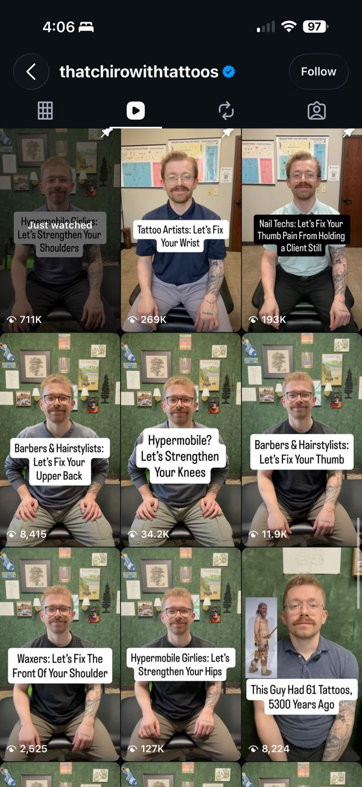</a> |
| **Oreo spine, part 2** | Spondylolisthesis, ankylosing spondylitis, degenerative disc, pinched nerve | Carousel | [@drwajeehapt](https://www.instagram.com/drwajeehapt/) | <a href="inspo/oreo-kyphosis.jpg">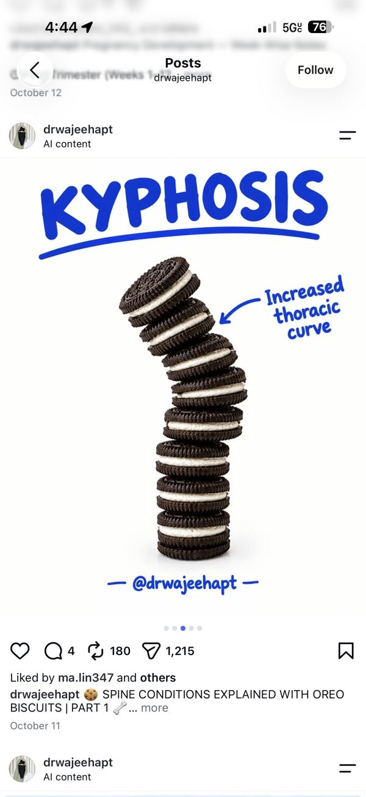</a> <a href="inspo/oreo-herniated-disc.jpg">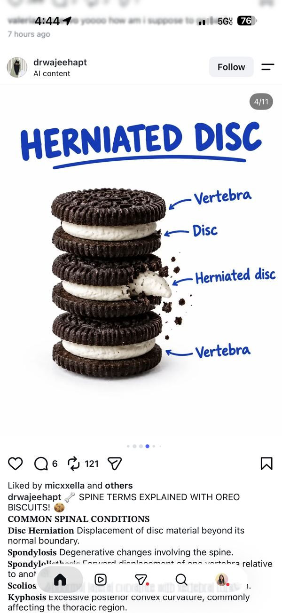</a> <a href="inspo/drwajeehapt-grid.jpg">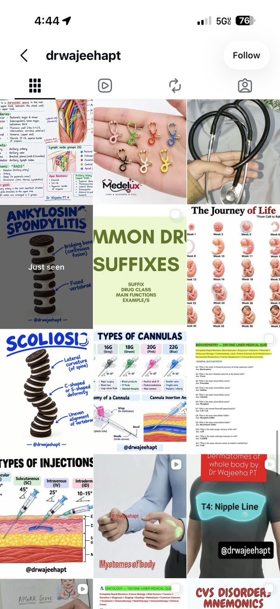</a> |
| **Sell the moment, not the treatment** | Life-event series: "Half marathon in 12 weeks? When to get that knee checked" · "Before your ski trip" · "Pregnancy timeline: when prenatal chiro helps" · "The thing patients wish they'd done earlier" | Carousel series | [@dariamedric](https://www.instagram.com/dariamedric/) | <a href="inspo/daria-1.jpg">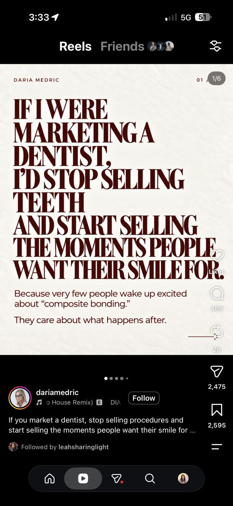</a> <a href="inspo/daria-3.jpg">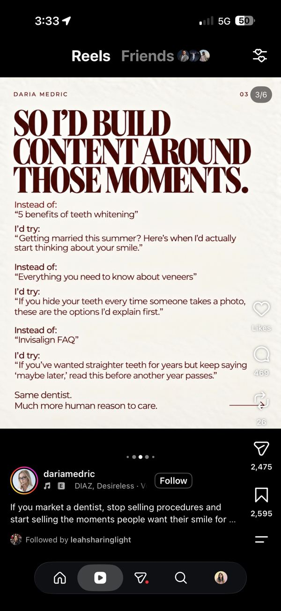</a> <a href="inspo/daria-5.jpg">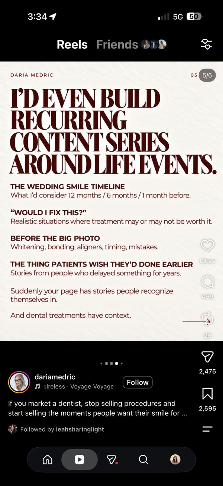</a> |
| **Calm "exercise without flaring" follow-along** | Eli or Dr. Paris in the rehab area, soft light, a big serif text overlay: "Welcome to the side of the internet where we get you back to your sport without flaring up" | Reel | [@thenervoussystem.ot](https://www.instagram.com/thenervoussystem.ot/) | <a href="inspo/nervoussystem-flare-free.jpg">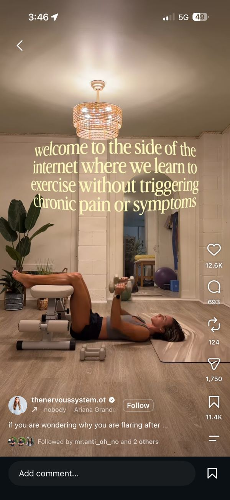</a> |
| **Hook list** | See "Hooks to steal" above. Pull one hook for every reel | Reference | [@therealbrianmark](https://www.instagram.com/p/DewsR-_mwfT/) | <a href="inspo/hooks-curiosity.jpg">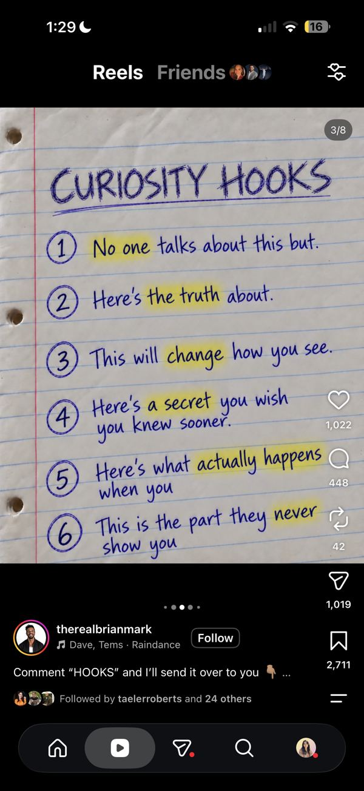</a> <a href="inspo/hooks-contrarian.jpg">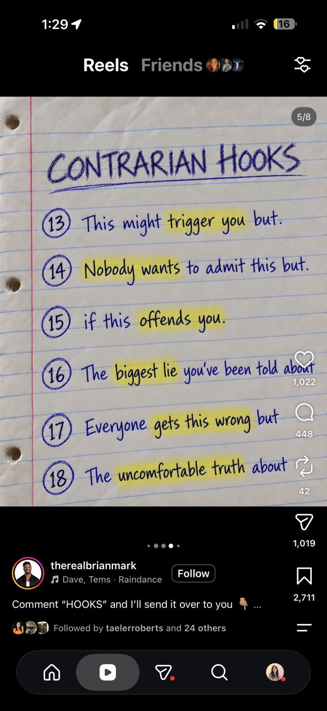</a> <a href="inspo/hooks-experience.jpg">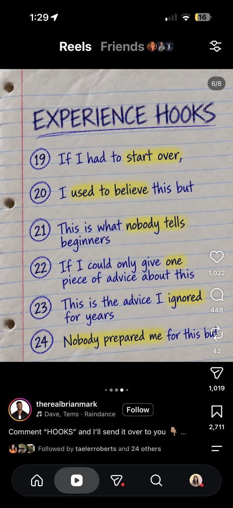</a> <a href="inspo/hooks-callout.jpg">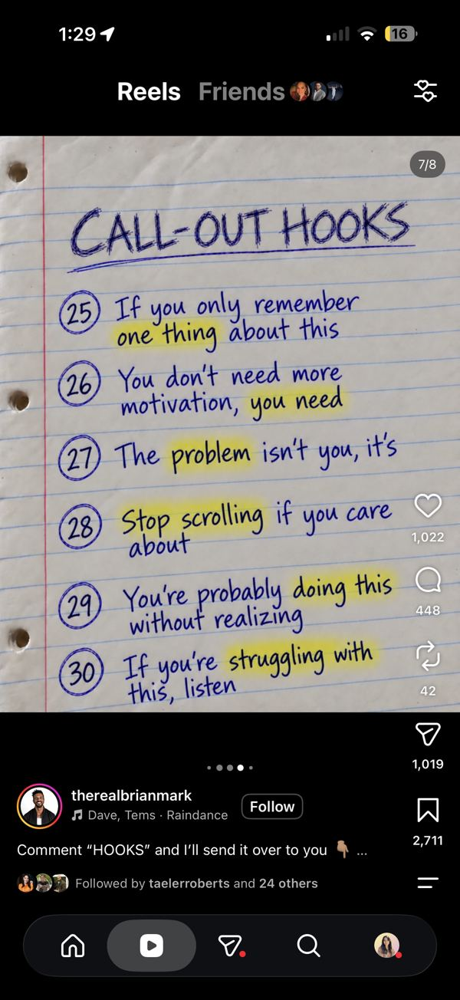</a> |
| **6 types of educational posts** | A monthly mix checklist: common mistake · myth vs. fact · step-by-step · framework · quick tips · do's & don'ts. November covers 4 of 6 | Reference | [@personalbrandlaunch](https://www.instagram.com/personalbrandlaunch/) | <a href="inspo/educational-post-types.jpg">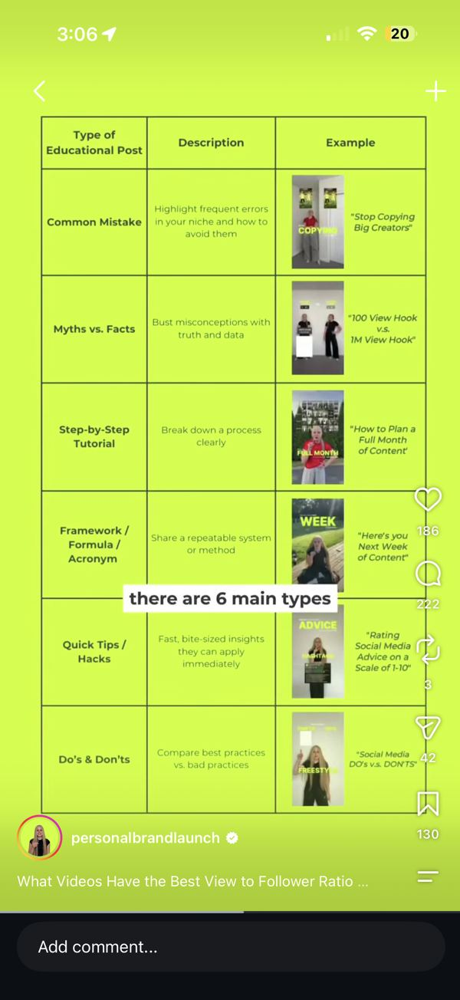</a> |

**Saved for later months** (need Eli, Nathalia, Dr. Paris or the full team): [@occhiropractor posture POV](https://www.instagram.com/p/DeNpizSJTzc/) · [@movement.chiropractic "unpopular things"](https://www.instagram.com/p/DdrQ_JhlAT6/) · [@medispine.ca team trend](https://www.instagram.com/p/DZmtIkbRJGy/) · [@balancedbodyjm massage POV](https://www.instagram.com/p/De0eI47zx6T/) · [@lonestarsportsrehab.btx massage humor](https://www.instagram.com/p/Dd2VKjUAN76/) · [@cassiethechiro](https://www.instagram.com/p/DdldqGiTqrq/) · [@atlanta_spine](https://www.instagram.com/p/DcLnx4vgoXj/) · [@alexathechiro movement break](https://www.instagram.com/p/Dcyq3e7Gx6q/) · [@dr.suzischulman](https://www.instagram.com/p/CxG9cjGO2Bq/)
